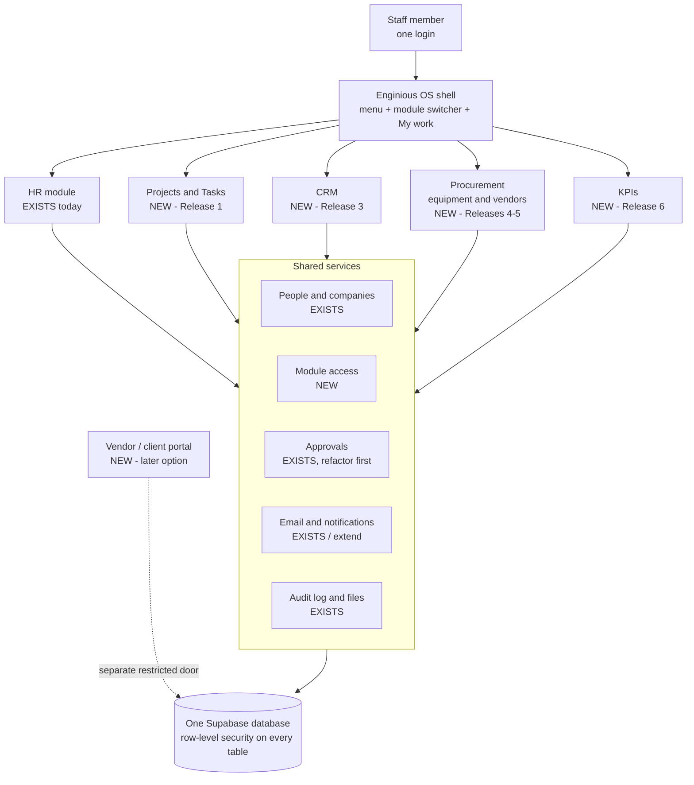
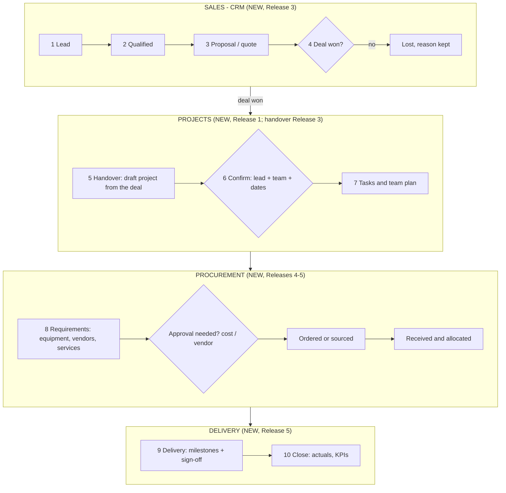

# 14. Enginious OS — architecture and phased roadmap (proposal)

> **Status: proposal only.** Nothing described as *proposed* here is built. This document changes no code, no database, no
> Supabase project and nothing in Production. No new Supabase project has been created. Everything marked **[EXISTS]** was
> inspected in this repository on 2026-10-17 (HR Engine, `main` at the time of writing); everything marked **[NEW]** is a
> proposal; **[CHANGE]** means "exists today, and would have to change".

**How to read this document.** §1 is the one-page summary and the decisions we need from you. §2 shows what the application
really is today. §3–§7 are the design (architecture, project leadership, the CRM-to-delivery workflow, staff-only versus outside
access, approvals). §8 is test environments and costs, kept separate on purpose. §9 is the phased roadmap with the smallest useful
first release. §10 is the page and menu map, §11 the decisions, §12 the risks.

| Label | Meaning |
|---|---|
| **[EXISTS]** | Built, deployed, inspected in the repository |
| **[CHANGE]** | Exists, but would need modification for Enginious OS |
| **[NEW]** | Proposed; does not exist yet |

---

## 1. Summary

**The idea.** Keep **one login and one application** for staff. HR Engine becomes the *HR module* of a bigger platform called
(working name) **Enginious OS**, next to new modules: Projects & Tasks, CRM, Procurement (equipment and vendors) and later KPIs.
The business chain we are designing for is:

> **CRM** (lead → deal won) → **confirmed project** → **tasks and team allocation** → **equipment / vendor requirements** → **delivery**

**What we recommend**

1. **One codebase, one Supabase project, one login, separate modules** ("modular monolith"), not several apps.
2. **Module access is its own thing.** A new, small access table says who may open which module. It does **not** reuse the seven HR
   roles, so HR permissions stay exactly as they are.
3. **Project leadership is separate from HR management.** A project lead is a *time-limited membership of one project*, never a
   change to who someone's line manager is, and it never reveals HR data (see §4).
4. **Reuse the approvals idea, but not by piling on to today's code** (§7): the engine is generic in its tables, but the "what
   happens when approved" logic lives in one very large function. The smallest first release needs no approvals at all.
5. **Staff-only first.** Vendors and clients come later, through a separate restricted door (§6), never by giving them staff accounts.
6. **A test environment is needed before the second module ships** (§8). We do not create one now.

**Smallest useful first release (Release 1): "Projects & Tasks, staff only."** Module access + a module switcher; projects with a
status; team members with an optional temporary project lead; tasks with assignee, status and due date; a "My work" view; email on
assignment. No CRM, no approvals, no vendors, no changes to attendance. Details in §9.

**Decisions we need from you** (the nine most urgent here; all fourteen, with options and timing, in §11):

| # | Decision | Our recommendation |
|---|---|---|
| D1 | Which first: Projects & Tasks, or CRM? | Projects & Tasks |
| D2 | Confirm the single-platform approach and the name | Yes |
| D3 | Who gets which module by default | All staff: Projects & Tasks as members; CRM/Procurement by invitation |
| D4 | What a temporary project lead may do | Manage tasks and team of that project only; no HR data |
| D5 | Reuse the existing `projects` table or start a new one | Reuse and tighten (after a read-only check that it is unused) |
| D6 | What makes a project "confirmed", and who confirms it | Deal won (or internal request) + lead + team + dates; confirmed by a Projects manager |
| D7 | Which new flows need approval, by whom, from what amount | Decide before Release 4 |
| D8 | Test environment option and budget | Local + one separate staging project (§8) |
| D9 | When do we start | After HR go-live and the postponed HR test |

---

## 2. What exists today (inspected)

### 2.1 The application in one paragraph

**[EXISTS]** A Next.js 16 web app (`apps/web`) on Vercel, backed by one Supabase project (Postgres 17, "Enginious HR Engine_V2",
Production). A monorepo with shared packages: `packages/domain` (business rules and permission mirrors), `packages/rls-tests`
(row-level-security tests on real Postgres, 23 files, 586 tests, run on PostgreSQL 16 and 17), `packages/e2e-tests` (browser tests).
Production changes to the database are applied **manually** as reviewed SQL; CI runs lint, typecheck, unit and RLS tests.

### 2.2 Capability inventory

| Area | Status | What is there (evidence) | Reuse for Enginious OS |
|---|---|---|---|
| **Login and accounts** | **[EXISTS]** | Supabase Auth; invite, set/reset password, account status and deactivation, sign-out-everywhere (`/login`, `/set-password`, `/account/security`, `/admin/users`) | **Reuse as is.** One staff login already exists. |
| **People and companies** | **[EXISTS]** | `employees` (company, country, department, `manager_id`), `companies`, `countries`, `departments` | Reuse: the people directory for every module |
| **Roles** | **[EXISTS]** | Seven fixed roles (`app_role`: employee, line_manager, hr_admin, finance, ceo, cto, sys_admin); grants in `user_roles`, scoped by company and/or country, revocable; helper `has_role()` | Reuse for HR. **Not suitable for module access** (see §3.3) |
| **Line-manager hierarchy** | **[EXISTS]** | `is_manager_of()` walks the **whole chain** of `employees.manager_id`: a manager sees leave, claims, allocations of everyone below them | Must **not** be reused for project leadership (§4) |
| **Menus and screens** | **[EXISTS]** | About 30 screens; one function builds the menu per role (`components/nav/nav-groups.ts`) | Extend with a module switcher |
| **Approvals engine** | **[EXISTS]** | See §7: tables `approval_workflows`, `approval_workflow_steps`, `approvals`; approver types; the shared CEO/CTO queue; the Approvals page | Reuse the concept; refactor before adding many new request types |
| **Projects** | **[EXISTS], no screens** | Tables `projects` (code, name, client text, billable, active) and `project_allocations` (employee, %, dates). **No page uses them** except the hidden Timesheets. Readable by **every signed-in user**; writable by HR Admin only | **[CHANGE]**: extend and tighten (D5) |
| **"Project lead" today** | **[EXISTS]** | Only a field (`project_lead_employee_id`) on attendance sessions and Recovery requests. It gives the lead **one approval step** on a request, nothing more | The right model to copy: narrow, time-limited, no HR access |
| **Assets** | **[EXISTS]** | `assets`, `asset_assignments`: company equipment issued to employees; page `/assets` visible to HR Admin and Finance only | Different thing from *project* equipment; link later |
| **Expenses** | **[EXISTS]** | `reimbursement_claims` and lines; each line can carry a `project_id` | Natural link: project cost |
| **Notifications** | **[EXISTS]** | Email through Microsoft Graph (`lib/email/graph.ts`); a `notifications` table that only the document-expiry job writes to | Reuse email; build the in-app side when needed |
| **Audit log** | **[EXISTS]** | `audit_log` plus 26 triggers; company-scoped; stores actor roles | Reuse: every new table gets a trigger |
| **Files** | **[EXISTS]** | Storage buckets with upload validation | Reuse |
| **Background jobs** | **[EXISTS]** | 5 Vercel crons (daily/monthly) and a 5-minute database job | Reuse; Vercel Hobby limits apply (§8.3) |
| **AI drafts** | **[EXISTS]** | `ai_drafts`: proposals that a human authorises | Reuse the pattern for suggestions |
| **Appraisals** | **[EXISTS]** | `/performance`: goals, cycles, appraisals | Later: KPIs feed it |
| **Module checklist** | **[EXISTS]** | `docs/09-extending-the-system.md`: migration, RLS from day one, RLS tests, domain permission file, UI route, docs | We follow it for every module |
| **CRM** (customers, contacts, leads, deals) | **[NEW]** | Nothing exists | Release 3 |
| **Tasks** | **[NEW]** | Nothing exists | Release 1 |
| **Vendors, requirements, purchasing, delivery** | **[NEW]** | Nothing exists | Releases 4–5 |
| **KPIs** | **[NEW]** | Nothing exists | Release 6 |
| **Module access** | **[NEW]** | No way today to say "this person may open Projects" | Release 1 |
| **External (vendor/client) users** | **[NEW]** | Every account today is an employee | Later option (§6) |

### 2.3 Findings that shape the design

1. **Approvals are generic in their tables, specific in their code (F1).** `approvable_entity` is a fixed list (leave, claim,
   timesheet, letter, onboarding task, offboarding task, payroll run, Recovery credit). What happens on approve, reject and
   "advance to the next step" is written as separate branches **per entity type inside one ~420-line function**
   (`decide_leave_approval`), and the Approvals page (838 lines) runs one query per entity type. Adding request types is possible,
   but each addition edits code that also protects leave, claims and payroll. Details and options in §7.
2. **The manager chain gives broad visibility (F2).** Because `is_manager_of()` is recursive, anything modelled as "manager" would
   also give HR-level visibility downward. Project leadership therefore needs its own relation (§4).
3. **`projects` is open for reading (F3).** Any signed-in user, in any company, can read every project including `client_name`.
   That was fine for picking a project on an expense line; it is not fine once projects carry customer, value or budget.
4. **Roles cannot express module access (F4).** Seven fixed roles, all HR-shaped. Adding roles like "sales_manager" would mix
   HR and non-HR meaning in one list.
5. **There is no safe place to try changes (F5).** Production changes are manual SQL and previews have no database (the
   preview deployments show an error today; already recorded as PTC-06 in `docs/13-post-test-corrections.md`).
6. **Hosting plan (F6).** The Vercel account is on the Hobby plan; see §8.3.
7. **All HR data lives in the same database (F7).** Salaries, IDs and contracts sit next to anything new. Separation must be
   enforced by row-level security and module access, and proven by tests, exactly as the HR tables are today.

---

## 3. Target architecture

### 3.1 The picture



### 3.2 Principles

- **One login, one app.** Modules are folders in the same app, behind the same sign-in. Staff never switch apps or accounts.
- **Each module follows the existing module checklist** (`docs/09`): its own migration, row-level security from the first commit,
  RLS tests that try to *fail* each policy, a domain permission file, UI routes, docs.
- **Modules link by IDs, not by reaching into each other's tables:** a project has a `customer_id`, an equipment requirement has a
  `project_id`, an expense line already has `project_id`.
- **Table names carry a module prefix** (`pm_`, `crm_`, `proc_`, `kpi_`) in the existing `public` schema, so the privilege
  hardening already applied to `public` (PR #30) covers new tables automatically, and nothing needs extra API configuration.
- **Each module can be switched on per person**, and hidden entirely until it is ready.
- **HR behaviour does not change.** The first release touches HR only by adding a switcher to the menu.

### 3.3 Module access (proposed, **[NEW]**)

A small table, separate from `user_roles`:

| Column | Meaning |
|---|---|
| `user_id` | the staff login |
| `module` | `projects`, `crm`, `procurement`, `kpi` (HR keeps using roles) |
| `access_level` | `member` (use it), `manager` (create/confirm/administer within the module) |
| `company_id` | optional: limit to one company |
| `granted_by`, `granted_at`, `revoked_at` | who/when; revocable, audited |

A helper `has_module_access(module, level, company)` is used by every module's row-level security and by the menu builder.
Sys Admin manages it on the existing **Users & Roles** page. Why not new roles: the seven roles stay purely HR-shaped, and a
person can be a Sales manager without touching anything HR-related.

---

## 4. Temporary project leadership versus HR management

These are different relationships and must stay different.

| | **HR management (exists)** | **Project leadership (proposed)** |
|---|---|---|
| What it is | Reporting line: `employees.manager_id`, roles in `user_roles` | Membership of one project: `pm_project_members` |
| How long | Until HR changes it | Has a **start and end date**; ends automatically |
| Reach | The person's **whole downward chain**, all companies they hold roles in | **One project** only |
| Can see | Leave, claims, allocations, attendance of reports (per policy) | The project, its tasks, its team's **names and project role** |
| Can do | Approve leave/claims, view HR records of reports | Manage that project's tasks, assign team members, raise requirements for it |
| Never | – | See salary, contracts, IDs, leave balances, Recovery credit or any HR page; approve HR requests; change anyone's manager |
| Set by | HR Admin | A Projects manager (module access `manager`) |

Proposed table **[NEW]** `pm_project_members(project_id, employee_id, project_role: lead | member | observer, starts_on, ends_on)`.
A row-level-security rule gives the lead extra rights **only where the row's `project_id` matches and today is inside the dates**.
Appointing or ending a lead is audited. **Existing precedent [EXISTS]:** Recovery Leave already gives a project lead a single
approval step on one request without any role: the same narrow idea, now made explicit and reusable.

---

## 5. The workflow: CRM to delivery



| Step | Who (proposed) | What happens | Exists today? |
|---|---|---|---|
| 1–3 Lead → Proposal | Sales (CRM `member`) | Customers, contacts, deals with stages, next-action reminders | **[NEW]** (Release 3) |
| 4 Deal won | Sales manager | Deal marked won; value, scope notes, customer recorded | **[NEW]** |
| 5 Handover | Sales manager | One click creates a **draft project** copying customer, value, dates; the deal stays linked | **[NEW]** |
| 6 Confirm | Projects manager | Draft becomes **confirmed** only when it has a lead, at least one team member and start/end dates (D6) | **[NEW]**; `projects` table **[CHANGE]** |
| 7 Tasks and team | Project lead | Team with allocation and dates; tasks with assignee, status, due date | Allocation table **[EXISTS]**, tasks **[NEW]** (Release 1) |
| 8 Requirements | Project lead | Equipment/vendor/service lines per project; request → approval → ordered → received | **[NEW]**; reuses approvals (§7) |
| 9 Delivery | Project lead | Milestones, delivery note, internal sign-off (customer sign-off only in the later portal) | **[NEW]** |
| 10 Close | Projects manager | Actuals recorded; feeds KPIs; expenses already link by `project_id` | Expense link **[EXISTS]** |

**Project status (proposed):** `draft → confirmed → active → delivered → closed` (plus `cancelled`).
Existing touch-points we deliberately **leave alone at first:** attendance still uses free-text project name and lead for Site work
(**[EXISTS]**, live and under test). Replacing that with a project picker is a later, separate change (D14 in §11),
because it touches the live Recovery Leave rules.

---

## 6. Staff-only first; restricted vendor/client access later

**Release 1–5: staff only.** Every user is an employee with a normal login. Vendors and customers appear only as *records*.

**Later option (not designed in detail, not scheduled):** a separate, narrow door for outside people. Principles to keep open now:

- Outsiders get a **different kind of account** (not an employee, no roles, no HR menu) and can reach **only** the records explicitly
  shared with them (for example "my purchase orders", "my documents to upload", "delivery sign-off for my project").
- Each external organisation sees only its own rows; staff see everything within their module access.
- Sign-in by emailed link (no shared passwords); every action audited; uploads validated with the existing rules.
- Decision needed *when we get there*: who is invited, what they can see and do, and whether a customer sign-off is required.

Cost of designing for it now is small: use `customer_id`/`vendor_id` on shared records and never put staff-only fields (internal
margin, internal notes) in the same row as anything an outsider could see.

---

## 7. Approvals: what exists, and what reuse would involve

### 7.1 What was inspected

- **Tables [EXISTS]:** `approval_workflows` (per company/country and entity type), `approval_workflow_steps` (ordered steps), `approvals`
  (one row per step: entity, approver, decision, comments). Each (entity, step) exists once.
- **Approver types [EXISTS]:** `direct_manager`, `manager_of_manager`, `role:hr_admin`, `role:finance`, `role:ceo` (CEO or CTO),
  `role_queue:hr_admin` (anyone holding the role may decide), and a per-request **queue of roles** (used for the shared CEO/CTO queue).
  `role:*` picks **one person** (the earliest grant), which is why a person holding many roles can end up approving their own items.
- **Conditions [EXISTS]:** a step can be skipped by an amount threshold (`amount_gt`) and nothing else.
- **Special rules [EXISTS]:** a CEO/CTO's own leave is approved automatically and their expense claims skip the manager and go
  straight to Finance; self-approval of step 1 is blocked; Recovery credit has its own route (employee: project lead → HR; manager: HR;
  HR: the shared CEO/CTO queue).
- **Where decisions happen [EXISTS]:** `decide_leave_approval()` (~420 lines): checks who may decide, then separate branches for
  finalise / reject / advance **per entity type**. Queue-role steps are currently allowed **only** for Recovery credit.
- **Screen [EXISTS]:** `/approvals` loads the waiting items with **one query per entity type** and renders per-type cards.
- **Not supported today [NEW needed]:** an approver who is a *project lead*, a *module manager*, or "the person who owns this vendor";
  generic "on approved / on rejected" actions; approval conditions other than amount.

### 7.2 Options

| Option | What it means | Verdict |
|---|---|---|
| **A. Add new entity types to today's code** | Add values to `approvable_entity`, add branches to the big function and cards to the Approvals page | Fast for one flow; every addition edits code that also guards leave, claims and payroll. Acceptable for **one** low-risk flow, not for many |
| **B. Refactor first, then reuse** | Introduce a small registry: each entity type registers its "on approved / rejected / next step" action; the big function becomes a dispatcher; the Approvals page gets a pluggable card per type. Add approver types `module_manager:<module>` and `project_lead` | **Recommended** before Release 4 (first new approval flow). Needs its own RLS/regression tests proving leave, claims and payroll behave identically |
| **C. A separate approvals table for new modules** | Build a second, simpler engine for Enginious OS | Two engines to maintain and two inboxes for staff: **not recommended** |

**Recommendation:** Release 1 needs no approvals. Do option B as the first task of Release 4, with the existing 586-test RLS suite
as the safety net, then register the new flows (requirement approval, vendor approval) on top.

---

## 8. Test environments and costs (separate from the roadmap)

**Nothing here is being created.** The Production database is not touched and no Supabase project is created by this document.

### 8.1 Why it matters

Today, changes are tested on a throwaway Postgres in CI (good for database rules, **not** for screens) and then applied manually
to Production. Previews show an error because they have no database settings (PTC-06). With several modules, trying changes on live
company data is not acceptable, and previews must never be pointed at Production.

### 8.2 Options

| Option | What it gives | Rough cost (USD, verify before deciding) | Limits / notes |
|---|---|---|---|
| **0. Today: CI Postgres only** | Automated tests of database rules (23 RLS files) | $0 | No screens, no manual try-out |
| **1. Local Supabase on a developer machine** (Docker) | Full app against a throwaway local database | $0 | One developer at a time; not shareable with the team |
| **2. A second Supabase project, "staging"** | A permanent shared test copy: real screens, real logins, test data only | Free plan: $0 but small (500 MB), may pause when idle, limit of two active free projects per organisation. Paid plan: about **$10/month** extra for another small project (the $10 monthly compute credit covers only one) | You apply migrations to it first, exactly as you would to Production; Vercel previews would point here |
| **3. Supabase branching** | A temporary database per pull request, deleted afterwards | Paid-plan feature; billed per branch-hour, reported at about **$0.01344/hour** (≈ $10/month if one branch ran all month) on top of the plan | Best once PRs are frequent; more automation to set up |
| **4. Do nothing** | – | $0 | **Not recommended** beyond Release 1 |

**Recommendation (D8):** Options 0 + 1 now (free), and **Option 2** before Release 2 (the first release that needs real previews
and shared testing). Branching (3) can be reconsidered when several people open PRs weekly. We create nothing until you choose.

### 8.3 Hosting plan (Vercel)

The Vercel organisation is on the **Hobby** plan. Vercel's own documentation says Hobby is restricted to **non-commercial,
personal use**; commercial use needs the **Pro** plan, reported at about **$20 per user per month**. Hobby also limits how often a
scheduled job can run (our five crons are daily or monthly; the 5-minute Recovery processor runs inside the database instead).
This is outside the scope of this proposal, but a company platform should be on a plan that permits it: **please check your plan
against Vercel's terms** (D8).

*Sources for the figures above (third-party summaries; the official pricing pages could not be fetched from this environment, so
confirm on them before budgeting):* [Supabase pricing](https://supabase.com/pricing.md) ·
[Schematic's Supabase pricing summary](https://schematichq.com/blog/supabase-pricing) ·
[Vercel Hobby plan](https://vercel.com/docs/accounts/plans/hobby).

---

## 9. Phased roadmap

**Gate before anything below starts:** the HR Engine is tested by the team and live (the postponed test week), and the corrections
we chose from `docs/13-post-test-corrections.md` are done or consciously deferred (D9). Sizes are relative (S/M/L), not time promises.

| Release | Name | Scope | Depends on | Size |
|---|---|---|---|---|
| **0** | **HR go-live** | Run the postponed HR test; fix the agreed items (PTC list) | – | – |
| **1** | **Projects & Tasks (staff only)** | See below | Release 0, decisions D1–D6 | **M** |
| **2** | **Staging + project depth** | Staging environment (§8); project files; project page polish; attendance project picker *only if* HR is stable | Release 1 live; D8 | S–M |
| **3** | **CRM lite → project handover** | Customers, contacts, deals with stages and reminders; "deal won → create draft project"; restricted visibility of deal values | Release 1; decision D10 (pipeline and data) | **M–L** |
| **4** | **Requirements and approvals** | Approvals refactor (§7 option B); equipment/vendor/service requirements per project with request → approval → ordered → received | Releases 1, 2 | **L** |
| **5** | **Vendors and delivery** | Vendor master and onboarding (documents with expiry reminders, approvals); delivery milestones and internal sign-off | Release 4 | **M** |
| **6** | **KPIs** | Dashboards derived from the other modules (sales value, pipeline, project on-time, task completion, utilisation); link to appraisals | Releases 3–5 | **M** |
| **Later** | **Restricted vendor/client access** | Separate narrow door (§6) | Releases 4–5 stable | **L** |

### 9.1 The smallest useful first release — Release 1: "Projects & Tasks, staff only"

**What is in**

- **Module access and switcher [NEW]:** the access table (§3.3), `has_module_access()`, a menu switcher; Sys Admin grants access on the existing Users & Roles page. Everyone keeps their HR menu unchanged.
- **Projects [CHANGE]:** reuse the `projects` table (D5) with a status (`draft → confirmed → active → delivered → closed`), dates, owner, a customer **name** (text until CRM exists). Tighten reading to members, leads, Projects managers, HR/Finance/CEO where needed.
- **Team and temporary lead [NEW]:** `pm_project_members` with role and dates (§4).
- **Tasks [NEW]:** `pm_tasks` (title, description, assignee, status todo/doing/blocked/done, due date, priority) and simple comments.
- **My work [NEW]:** a section on the existing Dashboard and a page listing my tasks and the projects I am on.
- **Email on assignment [EXISTS channel]:** reuse the Microsoft Graph sender.
- **Audit and tests [EXISTS pattern]:** audit triggers on the new tables; RLS tests for every policy, including "a lead cannot see HR data" and "a lead's rights end on the end date".

**What is deliberately out:** CRM, approvals, vendors/equipment, KPIs, attendance linkage, outside users, notifications inside the app.

**Why this one:** staff use it every day (building the habit that the later modules rely on); it creates the *project* object that
CRM, requirements and delivery all hang off; it exercises the new access model on low-sensitivity data; and it needs **no change to
approvals, attendance or any HR rule**.

**Alternative (if sales is your biggest pain):** CRM first. The trade-off is a pipeline that ends in a spreadsheet-style "won" with
nowhere for the work to go, and a bigger decision load up front (stages, data import, who sees values).

**Definition of done for Release 1**

1. A staff member with Projects access sees the module; one without it does not.
2. A Projects manager creates a project, adds a team, appoints a lead with an end date.
3. The lead creates and assigns tasks; assignees get an email and see them in My work.
4. The lead cannot open any HR page for team members; after the end date, lead rights disappear on their own.
5. Existing HR screens, tests and behaviour are unchanged (full RLS suite still green).
6. Applied to Production only after a read-only check and a staged manual SQL run, like every earlier change.

---

## 10. Page and menu map

### 10.1 Menu today versus proposed

```
TODAY (EXISTS)                         PROPOSED (adds a module switcher at the top)
Overview     Dashboard                 [ HR | Projects | Sales | Procurement | KPIs ]   <- switcher, NEW
             My Profile                (shown only for modules you have access to)
             My Attendance Clock
People       Employees                 HR   (all of today's menu, unchanged)
             Attendance                Projects  (NEW)  My work · Projects · (project page)
             Leave                     Sales     (NEW, Release 3)  Pipeline · Deals · Customers · Contacts
             Reimbursements            Procurement (NEW, Releases 4-5)  Requirements · Vendors · Orders
             Performance               KPIs      (NEW, Release 6)  Dashboards · Targets
Workflow     Approvals  Alerts
             Letters  Payroll          Dashboard (EXISTS, CHANGE): adds "My work today":
Organisation Assets  Policies                      tasks due, approvals waiting, my clock
             Holidays  Companies
Insights     AI Suggestions  Audit Log
System       Users & Roles             Users & Roles (EXISTS, CHANGE): adds module access
```

### 10.2 Pages by module

| Module | Page | Who | Purpose | Status | Release |
|---|---|---|---|---|---|
| Shell | Module switcher, My work on Dashboard | everyone | One place for today's work | **[CHANGE]/[NEW]** | 1 |
| Admin | Users & Roles → module access | Sys Admin | Grant or revoke a module | **[CHANGE]** | 1 |
| Projects | Projects list | module members | Find projects I belong to or manage | **[NEW]** | 1 |
| Projects | Project page: Overview · Team · Tasks | members/lead/manager | Status, dates, team, tasks | **[NEW]** | 1 |
| Projects | My tasks | everyone with access | What is assigned to me | **[NEW]** | 1 |
| Projects | Project files, timeline | members | Documents, key dates | **[NEW]** | 2 |
| Sales | Pipeline board, Deals, Customers, Contacts, Activities | sales users | Run the funnel | **[NEW]** | 3 |
| Sales | "Create project from won deal" | sales manager | Handover | **[NEW]** | 3 |
| Procurement | Requirements (per project and overall) | lead, procurement | Needs → request → status | **[NEW]** | 4 |
| Procurement | Vendors, Vendor onboarding | procurement | Master list, documents, approval | **[NEW]** | 5 |
| Approvals | Existing Approvals page gains new cards | approvers | One inbox for everything | **[CHANGE]** | 4 |
| Delivery | Milestones, delivery sign-off (project tab) | lead | Prove completion | **[NEW]** | 5 |
| KPIs | Dashboards, targets | managers | Measure | **[NEW]** | 6 |
| Portal | Vendor/client views | outsiders | Narrow, optional | **[NEW]** | Later |

### 10.3 Proposed new tables (sketch, not final)

`module_access` · `pm_project_members` · `pm_tasks` · `pm_task_comments` · (`projects` extended) · `crm_customers` · `crm_contacts` ·
`crm_deals` · `crm_activities` · `proc_requirements` · `proc_vendors` · `proc_vendor_documents` · `proc_orders` · `pm_milestones` ·
`kpi_targets`. Every table: company-scoped where relevant, row-level security from the first migration, an audit trigger, an RLS test file.

---

## 11. Decisions we need from you

| # | Decision | Options | Our recommendation | Needed before |
|---|---|---|---|---|
| D1 | First module | Projects & Tasks · CRM | Projects & Tasks | Release 1 |
| D2 | Single platform and name | One app "Enginious OS" · separate apps | One app, modular | Release 1 |
| D3 | Default module access | All staff / by invitation / by department | Projects & Tasks: all staff as members. CRM, Procurement, KPIs: by invitation | Release 1 |
| D4 | Temporary project lead powers | Manage tasks/team of that project only · plus budget view · plus approvals | Tasks and team of that project only; budget and approvals later and explicit | Release 1 |
| D5 | The existing `projects` table | Reuse and tighten · start a new table | Reuse and tighten, after we check (read-only) that V2 has no rows or only test rows | Release 1 |
| D6 | "Confirmed project" | Rule and who confirms | Needs a lead, one member and dates; confirmed by a Projects manager; from a won deal or an internal request | Release 1 |
| D7 | Which new flows need approval, by whom, above what amount (and currency) | Project confirmation · requirement over a threshold · vendor onboarding | Decide with Finance/CEO; none in Release 1 | Release 4 |
| D8 | Test environment and plans | Options in §8.2; Vercel plan (§8.3) | Local + one staging project before Release 2; check the Vercel plan | Release 2 |
| D9 | Start date | After HR go-live and the postponed HR test | Agree a date; do not overlap | Release 1 |
| D10 | CRM data | Is there an existing CRM/spreadsheet to import? What are the pipeline stages? Who may see deal values? | Answer before Release 3 | Release 3 |
| D11 | What "equipment" means | Individually tracked items (like Assets) · quantities/stock · both | Start with "requirement lines" only; stock later | Release 4 |
| D12 | Companies and countries | Projects per company (UAE only now) · cross-company | Per company, like everything else | Release 1 |
| D13 | Vendors and clients later | Who, what they may see/do | Confirm staff-only until Release 5 is stable | Later |
| D14 | Attendance project picker | Keep free text · switch to project list | Switch only after HR is stable, in its own change | Release 2+ |

---

## 12. Risks and how this plan handles them

| Risk | Handling |
|---|---|
| New modules destabilise HR | Release 1 changes no HR table and no HR rule; the full RLS suite must stay green; HR keeps its own menu |
| HR is not yet proven with real users | Gate: HR go-live first (D9) |
| A project lead ends up seeing HR data | Separate membership table; RLS tests that try to read HR data as a lead; no reuse of the manager chain |
| Customer/vendor data too widely visible (the `projects` table is open today) | Tighten `projects`; new tables get restrictive policies and tests from day one |
| Approvals code becomes unmaintainable | Refactor first (§7 option B), with the existing suite as safety net |
| No safe place to test | Staging before Release 2 (§8) |
| Scope creep ("one more module") | Releases are small and sequential; each must be in daily use before the next starts |
| Production changes stay manual | Keep the proven routine (read-only preflight → tested migration → verify SQL); revisit automation once staging exists |

---

## 13. What was and was not done to produce this

- **Done:** read the repository (schema, migrations, approvals engine, permission helpers, navigation, tests, CI, docs) and the
  earlier read-only Production checks recorded in this repository's history.
- **Not done:** no code, no migration, no Supabase project, no change to Production, no Vercel change. Cost figures come from
  public web summaries and must be confirmed on the official pricing pages.
