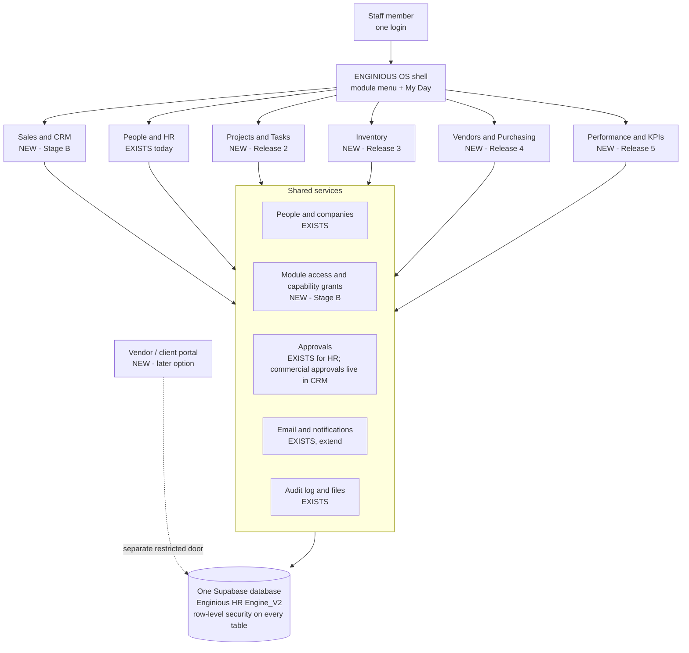
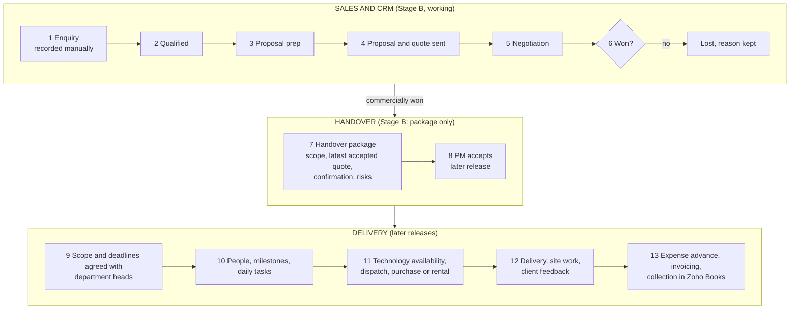

# 14. Enginious OS — architecture and phased roadmap (v2)

> **Status: roadmap v2, 2026-10-17.** Updated with the owner's decisions: **design the whole OS first (Stage A: a design
> preview with clearly labelled sample data), then implement Sales & CRM as the first new working module (Stage B).** This
> supersedes the "Projects first" release order of v1. Existing HR stays operational and unchanged and becomes **People & HR**
> at the approved rollout. Stage A changes no database, no Production setting and creates no hosted service.
>
> **HR is not described here as proven in company use.** The HR team-testing week was postponed; automated tests passing is not
> the same as staff relying on it every day. Labels: **[EXISTS]** = built and inspected in this repository, **[CHANGE]** = exists
> but must change, **[NEW]** = proposed, does not exist yet.

**How to read this document.** §1 summary and what changed. §2 what exists today (inspected). §3–§8 the design: architecture,
project leadership, the enquiry-to-delivery workflow, staff-only versus outside access, approvals, test environments and costs.
§9 the roadmap. §10 the menu and page map. §11 the Sales & CRM specification for Stage B. §12 the Stage A design preview.
§13 decisions (resolved and still open). §14 risks. §15 what was and was not done.

---

## 1. Summary

### 1.1 What changed in v2

| Topic | Decision (owner brief, 2026-10-17) |
|---|---|
| Order of work | Design the whole OS first (Stage A), then build **Sales & CRM** first (Stage B). Projects & Tasks is no longer first |
| Stage A | A design preview of the overall OS and a detailed Sales & CRM experience, **sample data only**, deployed as a preview, then a **stop for visual review** |
| Stage B | Working Sales & CRM (database, permissions, tests, manual deployment instructions) **only after** design approval. Design approval is **not** permission to run Production SQL, merge or deploy to Production |
| Existing application | Authentication, HR permissions, attendance, Recovery Leave, leave, expenses, payroll and appraisals keep working. No rewrite of HR calculations, no refactor of the shared approval engine for the shell or preview |
| Infrastructure | Production database stays **Enginious HR Engine_V2**. No new hosted Supabase project, no purchases, no credential or database moves. Repository, Supabase project name and live URL unchanged for now |
| Branding | User-facing rename to **ENGINIOUS OS** at the approved rollout; existing HR becomes **People & HR** |
| Access | One staff login and one application, with protected modules |
| Sales visibility | Staff granted Sales access see **all** opportunities in their authorised scope; CRM is **not** visible to every employee |
| Sales authority | Juzar and Rafi assign and reassign ownership; the owner (or a founder) closes an opportunity; HR/Finance/technical-admin roles grant none of this |
| Data entry | Manual only (website enquiries included). No WhatsApp, Instagram, LinkedIn or website integrations in this release |
| Proposals and pricing | Canva/ChatGPT stay outside the app; **Zoho Books stays the source** for quotations, invoices and payments (references and dated manual statuses only) |
| Project Head | "Project Head" and "PM" are the same person |

### 1.2 The ten modules

| # | Module | Covers | Today | Stage A preview | First real release |
|---|---|---|---|---|---|
| 1 | **My Day** | Role-appropriate home: tasks, follow-ups, clock, decisions | **[CHANGE]** existing dashboard | Five role homes | Stage B: adds Sales items for Sales users; others unchanged |
| 2 | **Sales & CRM** | Enquiries, pipeline, follow-ups, proposals, confirmation, handover | **[NEW]** | **Detailed design** (12 pages + states) | **Stage B** |
| 3 | **Projects & Tasks** | Projects, PM, department heads, assignments, milestones, tasks, site reservations | **[NEW]** | Representative screens | *Coming soon* |
| 4 | **People & HR** | Everything HR does today | **[EXISTS]** | Not redrawn; link to the live app | Unchanged (renamed) |
| 5 | **Inventory** | Technology stock, components, dispatch, return, condition | **[NEW]** (distinct from Assets) | Representative screens | *Coming soon* |
| 6 | **Vendors & Purchasing** | Vendors, purchase and rental requests (Admin) | **[NEW]** | Representative screens | *Coming soon* |
| 7 | **Performance & KPIs** | Appraisals (existing) plus KPIs | appraisals **[EXISTS]**; KPIs **[NEW]** | "Not collecting data yet" | *Coming soon* (appraisals unchanged) |
| 8 | **Approvals** | One inbox of decisions | **[EXISTS]** (HR flows) | Unified-inbox design | Unchanged in Stage B; commercial approvals live inside Sales & CRM |
| 9 | **Reports** | Cross-module reporting | **[NEW]** | Catalogue + sales reports | Sales reports only, inside Sales & CRM |
| 10 | **Administration** | Users, roles, module access, settings, audit | **[EXISTS]** users/roles/companies | Module-access design | Stage B: module access and Sales settings |

### 1.3 How Enginious operates (the design input)

We deliver experiential technology projects for agencies and end clients, mainly in the UAE, KSA and Europe.

- **Enquiries** arrive from outbound agency calls, LinkedIn, direct clients, WhatsApp, Instagram, website enquiries and referrals. We record the agency, end client, contacts, location, installation/show dates, scope, requested technologies and budget if known.
- **Proposals** are prepared manually (Canva and ChatGPT). **Quotes and invoices** are issued in Zoho Books. Pricing is mainly Juzar or Rafi, sometimes Sales.
- **Confirmation:** a purchase order is the main evidence; an authorised email can also confirm a job.
- **Handover:** Sales hands over to a **Project Manager (PM)**. The PM agrees scope and deadlines with the **Programming, Content and Engineering heads**, who assign their people, milestones and daily tasks. The PM coordinates delivery and client feedback.
- **Staff** in Programming and Content work across several projects at once; heads plan in **days and deadlines**, not hourly timesheets. **Physical/site assignments** need exact, non-overlapping time reservations (allowing travel and preparation), applied **by assignment type, not job title**.
- **Technology availability:** Sales checks technology-level availability; PM and Warehouse handle components, dispatch, return and condition; Admin arranges purchasing and rentals.
- **Money:** before site work the PM requests an **expense advance** (people, days, categories); Finance issues cash or Pluto-card funding and reconciles actuals; **Accounts** invoices and collects in Zoho Books.
- **The two immediate problems:** (1) enquiries and follow-ups get missed; (2) project ownership, staffing, priorities and client feedback are poorly coordinated.

### 1.4 The two stages

- **Stage A (this PR): design.** The OS shell, five role homes, the detailed Sales & CRM pages with loading/empty/error/permission-denied/overdue states, and representative screens for the later modules. Sample data only, in an isolated route that is **hidden in Production**. Stops for your visual review.
- **Stage B (after approval): working Sales & CRM.** Database changes (applied by you manually), permissions enforced in the database, tests, and manual deployment instructions. Later modules show **Coming soon** with no working-looking actions.

### 1.5 Recommendations that still stand from v1

One codebase, one Supabase project, one login, separate modules; module access in its own table (not new HR roles); project leadership is a time-limited membership, never a change to HR management; staff-only first with a restricted vendor/client door later; no new test project until you choose (§8).

The decisions that are **resolved by your brief**, and the **genuinely open** ones for Stage B, are listed in §13.

---

## 2. What exists today (inspected)

### 2.1 The application in one paragraph

**[EXISTS]** A Next.js 16 web app (`apps/web`) on Vercel, backed by one Supabase project (Postgres 17, "Enginious HR Engine_V2",
Production). A monorepo with shared packages: `packages/domain` (business rules and permission mirrors), `packages/rls-tests`
(row-level-security tests on real Postgres, 23 files, 586 tests, run on PostgreSQL 16 and 17), `packages/e2e-tests` (browser tests).
Production changes to the database are applied **manually** as reviewed SQL; CI runs lint, typecheck, unit and RLS tests.

### 2.2 Capability inventory

| Area | Status | What is there (evidence) | Reuse for Enginious OS |
|---|---|---|---|
| **Login and accounts** | **[EXISTS]** | Supabase Auth; invite, set/reset password, account status and deactivation, sign-out-everywhere (`/login`, `/set-password`, `/account/security`, `/admin/users`) | **Reuse as is.** One staff login already exists. |
| **People and companies** | **[EXISTS]** | `employees` (company, country, department, `manager_id`), `companies`, `countries`, `departments` | Reuse: the people directory for every module |
| **Roles** | **[EXISTS]** | Seven fixed roles (`app_role`: employee, line_manager, hr_admin, finance, ceo, cto, sys_admin); grants in `user_roles`, scoped by company and/or country, revocable; helper `has_role()` | Reuse for HR. **Not suitable for module access** (see §3.3) |
| **Line-manager hierarchy** | **[EXISTS]** | `is_manager_of()` walks the **whole chain** of `employees.manager_id`: a manager sees leave, claims, allocations of everyone below them | Must **not** be reused for project leadership (§4) |
| **Menus and screens** | **[EXISTS]** | About 30 screens; one function builds the menu per role (`components/nav/nav-groups.ts`) | Extend with a module switcher |
| **Approvals engine** | **[EXISTS]** | See §7: tables `approval_workflows`, `approval_workflow_steps`, `approvals`; approver types; the shared CEO/CTO queue; the Approvals page | Reuse the concept; refactor before adding many new request types |
| **Projects** | **[EXISTS], no screens** | Tables `projects` (code, name, client text, billable, active) and `project_allocations` (employee, %, dates). **No page uses them** except the hidden Timesheets. Readable by **every signed-in user**; writable by HR Admin only | **[CHANGE]**: extend and tighten in Release 2 (Projects & Tasks) |
| **"Project lead" today** | **[EXISTS]** | Only a field (`project_lead_employee_id`) on attendance sessions and Recovery requests. It gives the lead **one approval step** on a request, nothing more | The right model to copy: narrow, time-limited, no HR access |
| **Assets** | **[EXISTS]** | `assets`, `asset_assignments`: company equipment issued to employees; page `/assets` visible to HR Admin and Finance only | Different thing from *project* equipment; link later |
| **Expenses** | **[EXISTS]** | `reimbursement_claims` and lines; each line can carry a `project_id` | Natural link: project cost |
| **Notifications** | **[EXISTS]** | Email through Microsoft Graph (`lib/email/graph.ts`); a `notifications` table that only the document-expiry job writes to | Reuse email; build the in-app side when needed |
| **Audit log** | **[EXISTS]** | `audit_log` plus 26 triggers; company-scoped; stores actor roles | Reuse: every new table gets a trigger |
| **Files** | **[EXISTS]** | Storage buckets with upload validation | Reuse |
| **Background jobs** | **[EXISTS]** | 5 Vercel crons (daily/monthly) and a 5-minute database job | Reuse; Vercel Hobby limits apply (§8.3) |
| **AI drafts** | **[EXISTS]** | `ai_drafts`: proposals that a human authorises | Reuse the pattern for suggestions |
| **Appraisals** | **[EXISTS]** | `/performance`: goals, cycles, appraisals | Later: KPIs feed it |
| **Module checklist** | **[EXISTS]** | `docs/09-extending-the-system.md`: migration, RLS from day one, RLS tests, domain permission file, UI route, docs | We follow it for every module |
| **CRM** (customers, contacts, leads, deals) | **[NEW]** | Nothing exists | **Stage B** (first working module) |
| **Tasks** | **[NEW]** | Nothing exists | Release 2 (Projects & Tasks) |
| **Vendors, requirements, purchasing, delivery** | **[NEW]** | Nothing exists | Releases 3–4 (Inventory, Vendors & Purchasing) |
| **KPIs** | **[NEW]** | Nothing exists | Release 5 (Performance & KPIs) |
| **Module access** | **[NEW]** | No way today to say "this person may open Sales" | **Stage B** |
| **External (vendor/client) users** | **[NEW]** | Every account today is an employee | Later option (§6) |

### 2.3 Findings that shape the design

1. **Approvals are generic in their tables, specific in their code (F1).** `approvable_entity` is a fixed list (leave, claim,
   timesheet, letter, onboarding task, offboarding task, payroll run, Recovery credit). What happens on approve, reject and
   "advance to the next step" is written as separate branches **per entity type inside one ~420-line function**
   (`decide_leave_approval`), and the Approvals page (838 lines) runs one query per entity type. Adding request types is possible,
   but each addition edits code that also protects leave, claims and payroll. Details and options in §7.
2. **The manager chain gives broad visibility (F2).** Because `is_manager_of()` is recursive, anything modelled as "manager" would
   also give HR-level visibility downward. Project leadership therefore needs its own relation (§4).
3. **`projects` is open for reading (F3).** Any signed-in user, in any company, can read every project including `client_name`.
   That was fine for picking a project on an expense line; it is not fine once projects carry customer, value or budget.
4. **Roles cannot express module access (F4).** Seven fixed roles, all HR-shaped. Adding roles like "sales_manager" would mix
   HR and non-HR meaning in one list.
5. **There is no safe place to try changes (F5).** Production changes are manual SQL and previews have no database (the
   preview deployments show an error today; already recorded as PTC-06 in `docs/13-post-test-corrections.md`).
6. **Hosting plan (F6).** The Vercel account is on the Hobby plan; see §8.3.
7. **All HR data lives in the same database (F7).** Salaries, IDs and contracts sit next to anything new. Separation must be
   enforced by row-level security and module access, and proven by tests, exactly as the HR tables are today.

---

## 3. Target architecture

### 3.1 The picture



### 3.2 Principles

- **One login, one app.** Modules are folders in the same app, behind the same sign-in. Staff never switch apps or accounts.
- **Each module follows the existing module checklist** (`docs/09`): its own migration, row-level security from the first commit,
  RLS tests that try to *fail* each policy, a domain permission file, UI routes, docs.
- **Modules link by IDs, not by reaching into each other's tables.**
- **Table names carry a module prefix** (`crm_`, `pm_`, `inv_`, `proc_`, `kpi_`) in the existing `public` schema, so the privilege
  hardening already applied to `public` (PR #30) covers new tables automatically.
- **Each module is hidden from anyone without access**, and unfinished modules show **Coming soon** with no working-looking actions.
- **HR behaviour does not change.** The shell adds a module menu around today's HR screens; it does not alter an HR rule.

### 3.3 Module access and capability grants (proposed, **[NEW]**, Stage B)

Two small tables, separate from `user_roles` so the seven HR roles stay purely HR-shaped.

**`module_access`**: who may open which module.

| Column | Meaning |
|---|---|
| `user_id` | the staff login |
| `module` | `sales`, later `projects`, `inventory`, `procurement`, `performance` (People & HR keeps using roles) |
| `company_id` | optional: limit to one owning company (the authorised scope) |
| `granted_by`, `granted_at`, `revoked_at` | who/when; revocable, audited |

**`capability_grants`**: narrow, named powers that are **never derived from an HR, Finance or technical-admin role**.

| Capability | Meaning | Initial holders |
|---|---|---|
| `crm.assign_owner` | assign and reassign opportunity ownership | Juzar and Rafi only |
| `crm.cross_company_overview` | see Sales totals across owning companies | authorised founders (to be named) |
| `crm.approve_pricing` | record an internal commercial approval | **not decided** (see §13, open) |
| `crm.configure` | change Sales settings (stages labels, targets, calendar) | **not decided** |

Helpers `has_module_access(module, company)` and `has_capability(capability, company)` are used by every Sales policy and by
the menu builder. Having Sales access never grants salary or any other confidential HR data, and the reverse holds: a Sys Admin, HR
Admin or Finance role does **not** by itself confer Sales access, assignment rights or commercial powers.

---

## 4. Temporary project leadership versus HR management

These are different relationships and must stay different.

| | **HR management (exists)** | **Project leadership (proposed)** |
|---|---|---|
| What it is | Reporting line: `employees.manager_id`, roles in `user_roles` | Membership of one project: `pm_project_members` |
| How long | Until HR changes it | Has a **start and end date**; ends automatically |
| Reach | The person's **whole downward chain**, all companies they hold roles in | **One project** only |
| Can see | Leave, claims, allocations, attendance of reports (per policy) | The project, its tasks, its team's **names and project role** |
| Can do | Approve leave/claims, view HR records of reports | Manage that project's tasks, assign team members, raise requirements for it |
| Never | – | See salary, contracts, IDs, leave balances, Recovery credit or any HR page; approve HR requests; change anyone's manager |
| Set by | HR Admin | A Projects manager (module access `manager`) |

Proposed table **[NEW]** `pm_project_members(project_id, employee_id, project_role: lead | member | observer, starts_on, ends_on)`.
A row-level-security rule gives the lead extra rights **only where the row's `project_id` matches and today is inside the dates**.
Appointing or ending a lead is audited. **Existing precedent [EXISTS]:** Recovery Leave already gives a project lead a single
approval step on one request without any role: the same narrow idea, now made explicit and reusable.

---

## 5. The workflow: enquiry to delivery



| Step | Who | What happens | Exists today? |
|---|---|---|---|
| 1 Enquiry | Sales user (any source, entered by hand) | Title/brief, source, agency or client, next action and date. Unknown dates, budget and scope are allowed | **[NEW]** Stage B |
| 2–5 Qualification to negotiation | Owner, with others collaborating | Controlled stage transitions; activities; proposal and quote **references and versions**; internal commercial approval where configured | **[NEW]** Stage B |
| 6 Won / Lost | The owner (or an authorised founder) | **Won** needs PO or authorised-email evidence (type and date). **Lost** needs a reason. Reopening and corrections are audited | **[NEW]** Stage B |
| 7 Handover | Owner | Builds a **handover package**: accepted scope and exclusions, latest accepted proposal/quote, confirmation, promised technologies, dates, contacts, payment terms, unresolved risks. It is **not a project** | **[NEW]** Stage B |
| 8 PM accepts | Project Manager | "Commercially won", "Handover prepared" and "PM accepted" are three separate states | **[NEW]** Release 2 |
| 9–10 Scope, people, tasks | PM, Programming/Content/Engineering heads | Deadlines in **days**; heads assign people, milestones, daily tasks; site work uses exact non-overlapping reservations by **assignment type** | **[NEW]** Release 2; allocations table **[EXISTS]** |
| 11 Technology | Sales (availability), PM and Warehouse, Admin | Technology-level availability, components, dispatch, return, condition, purchase or rental requests | **[NEW]** Releases 3–4 |
| 12 Delivery | PM | Delivery and client feedback | **[NEW]** Release 2 |
| 13 Money | PM requests advance; Finance reconciles; Accounts invoices | Zoho Books remains the source of quotes, invoices and payments | Expense claims **[EXISTS]**; links **[NEW]** later |

**Three things that must never be conflated:** *quotation sent* ≠ *invoice issued* ≠ *payment received*. They are dated, separate
manual statuses with a Zoho reference each.

Existing touch-points deliberately **left alone**: attendance still uses free-text project name and project lead for Site work
(**[EXISTS]**), because it carries the live Recovery Leave rules, and **the narrow project-lead approval right for Recovery Leave is preserved**.

---

## 6. Staff-only first; restricted vendor/client access later

**Stage B and every release in §9 until further notice: staff only.** Every user is an employee with a normal login. Vendors and customers appear only as *records*.

**Later option (not designed in detail, not scheduled):** a separate, narrow door for outside people. Principles to keep open now:

- Outsiders get a **different kind of account** (not an employee, no roles, no HR menu) and can reach **only** the records explicitly
  shared with them (for example "my purchase orders", "my documents to upload", "delivery sign-off for my project").
- Each external organisation sees only its own rows; staff see everything within their module access.
- Sign-in by emailed link (no shared passwords); every action audited; uploads validated with the existing rules.
- Decision needed *when we get there*: who is invited, what they can see and do, and whether a customer sign-off is required.

Cost of designing for it now is small: use `customer_id`/`vendor_id` on shared records and never put staff-only fields (internal
margin, internal notes) in the same row as anything an outsider could see.

---

## 7. Approvals: what exists, and what reuse would involve

### 7.1 What was inspected (unchanged from v1)

- **Tables [EXISTS]:** `approval_workflows` (per company/country and entity type), `approval_workflow_steps` (ordered steps), `approvals`
  (one row per step: entity, approver, decision, comments). Each (entity, step) exists once.
- **Approver types [EXISTS]:** `direct_manager`, `manager_of_manager`, `role:hr_admin`, `role:finance`, `role:ceo` (CEO or CTO),
  `role_queue:hr_admin`, and a per-request **queue of roles** (used for the shared CEO/CTO queue). `role:*` picks **one person**.
- **Conditions [EXISTS]:** a step can be skipped by an amount threshold (`amount_gt`) and nothing else.
- **Special rules [EXISTS]:** CEO/CTO leave is auto-approved; their claims go straight to Finance; self-approval of step 1 is blocked;
  Recovery credit has its own route (employee: project lead → HR; manager: HR; HR: the shared CEO/CTO queue).
- **Where decisions happen [EXISTS]:** `decide_leave_approval()` (~420 lines) with separate branches per entity type; `/approvals`
  runs one query per entity type (838 lines).

### 7.2 Decision for Stage B (changed in v2)

**Do not edit the shared approval engine for Sales.** The brief asks for a *configurable internal commercial approval* with no invented
thresholds, margins or approvers, and for the **approver's instruction to be distinct from the preparer/sender**. That is a small,
self-contained record inside Sales & CRM:

- `crm_commercial_approvals`: opportunity, proposal/quote version, requested by, approver, decision, instruction text, decided at.
- Who may approve is a **capability** (`crm.approve_pricing`, §3.3), not an HR role. Whether approval is needed at all, and above
  what value per currency, is **configuration** and starts **switched off** until the owner supplies the rule.
- An approved price/version is **locked**; a change creates a new version and needs a new approval. It is never silently edited.
- The existing `/approvals` page is **unchanged** in Stage B. The design preview shows how a unified inbox could later list
  commercial items next to HR items; that is a future refactor (option B in the v1 analysis), not part of Stage B.

| Option for the *future* unified inbox | Verdict |
|---|---|
| A. Add entity types to today's code | Acceptable for one low-risk flow; not for many |
| B. Refactor first (registry of "on approved/rejected" actions), then reuse | **Recommended later**, with the existing RLS suite as safety net |
| C. A second approvals engine | Not recommended |

---

## 8. Test environments and costs (separate from the roadmap)

**Nothing here is being created.** The Production database is not touched and no Supabase project is created by this document.

### 8.1 Why it matters

Today, changes are tested on a throwaway Postgres in CI (good for database rules, **not** for screens) and then applied manually
to Production. Previews show an error because they have no database settings (PTC-06). With several modules, trying changes on live
company data is not acceptable, and previews must never be pointed at Production.

### 8.2 Options

| Option | What it gives | Rough cost (USD, verify before deciding) | Limits / notes |
|---|---|---|---|
| **0. Today: CI Postgres only** | Automated tests of database rules (23 RLS files) | $0 | No screens, no manual try-out |
| **1. Local Supabase on a developer machine** (Docker) | Full app against a throwaway local database | $0 | One developer at a time; not shareable with the team |
| **2. A second Supabase project, "staging"** | A permanent shared test copy: real screens, real logins, test data only | Free plan: $0 but small (500 MB), may pause when idle, limit of two active free projects per organisation. Paid plan: about **$10/month** extra for another small project (the $10 monthly compute credit covers only one) | You apply migrations to it first, exactly as you would to Production; Vercel previews would point here |
| **3. Supabase branching** | A temporary database per pull request, deleted afterwards | Paid-plan feature; billed per branch-hour, reported at about **$0.01344/hour** (≈ $10/month if one branch ran all month) on top of the plan | Best once PRs are frequent; more automation to set up |
| **4. Do nothing** | – | $0 | **Not recommended** once more than one working module exists |

**Recommendation:** Options 0 + 1 now (free), and **Option 2** before Release 2 (the first release after Sales & CRM that needs real previews
and shared testing). Branching (3) can be reconsidered when several people open PRs weekly. We create nothing until you choose.

### 8.3 Hosting plan (Vercel)

The Vercel organisation is on the **Hobby** plan. Vercel's own documentation says Hobby is restricted to **non-commercial,
personal use**; commercial use needs the **Pro** plan, reported at about **$20 per user per month**. Hobby also limits how often a
scheduled job can run (our five crons are daily or monthly; the 5-minute Recovery processor runs inside the database instead).
This is outside the scope of this proposal, but a company platform should be on a plan that permits it: **please check your plan
against Vercel's terms**.

*Sources for the figures above (third-party summaries; the official pricing pages could not be fetched from this environment, so
confirm on them before budgeting):* [Supabase pricing](https://supabase.com/pricing.md) ·
[Schematic's Supabase pricing summary](https://schematichq.com/blog/supabase-pricing) ·
[Vercel Hobby plan](https://vercel.com/docs/accounts/plans/hobby).

---

## 9. Phased roadmap

| Step | Name | Scope | Gate |
|---|---|---|---|
| **Stage A** | **Design preview** (this PR) | OS shell, five role homes, detailed Sales & CRM pages with states, representative screens for later modules; sample data only; isolated route hidden in Production | Owner's **visual review** |
| **Stage B** | **Sales & CRM, working** | `module_access` + `capability_grants`; `crm_*` tables with RLS, audit, tests; opportunities, follow-ups, activities, proposals/quote references, won/lost, handover package, Sales reports, Sales settings; optional reviewed import. Manual deployment instructions (read-only preflight → tested migration → verify SQL) | Design approval **and** your separate approval to proceed; migrations applied by you manually |
| **Release 2** | **Projects & Tasks** | PM acceptance of handover, projects, department-head assignment, milestones, tasks, site reservations (by assignment type) | Stage B in daily use |
| **Release 3** | **Inventory** | Technology stock, components, dispatch, return, condition. Distinct from Purchasing and from the existing employee **Assets** | Release 2 |
| **Release 4** | **Vendors & Purchasing** | Vendors; purchase and rental requests for Admin; links to project requirements | Release 3; decision on approvals refactor |
| **Release 5** | **Performance & KPIs, Reports** | KPIs from collected data (appraisals stay as today); cross-module Reports | Data exists to measure |
| **Later** | **Restricted vendor/client access** | Separate narrow door (§6) | Earlier releases stable |

**HR:** People & HR is not scheduled work; it stays operational. The postponed HR team-test week remains a separate matter and HR is
**not** described as proven in company use.

### 9.1 What Stage B contains (the smallest useful working module)

- Module access and the two capabilities `crm.assign_owner`, `crm.cross_company_overview` (others added when decided).
- Opportunities with controlled stages, owner and next action; clients/agencies and contacts; activities and follow-ups with
  configurable targets; proposal/quote references with versions; availability states; won/lost; handover package; reports; settings.
- **Out of Stage B:** integrations (WhatsApp, Instagram, LinkedIn, website), automatic client messages, quote/invoice creation
  (Zoho Books stays the source), projects, tasks, inventory, purchasing, KPIs, outside users.

**Definition of done for Stage B:** a Sales user (and only a user with Sales access) can record an enquiry in seconds, nobody
without access sees CRM data, only authorised users can assign owners or close, nothing here reveals HR data, all RLS tests
including negative ones pass, the full existing suite is unchanged and green, and the Production SQL is applied manually by you
after read-only checks.

---

## 10. Page and menu map

### 10.1 Navigation

A **left module sidebar** (collapsing to a bottom bar / drawer on mobile) lists the ten modules; opening a module shows its own
secondary navigation. This replaces one long role-based list.

```
My Day                      (role home)
Sales & CRM                 Overview · Opportunities · Pipeline · New enquiry · Clients · Follow-ups · Proposals · Reports · Settings
Projects & Tasks            (Coming soon)
People & HR                 today's existing menu, unchanged (opens the live HR screens)
Inventory                   (Coming soon)
Vendors & Purchasing        (Coming soon)
Performance & KPIs          (Coming soon; appraisals unchanged)
Approvals                   (existing inbox)
Reports                     (Coming soon; Sales reports live in Sales)
Administration              Users & roles (existing) · Module access (Stage B) · Companies · Audit log
```

### 10.2 Sales & CRM pages (Stage A designs these in detail)

| # | Page | Purpose | Who |
|---|---|---|---|
| 1 | Sales overview | What needs attention now: awaiting first response, due today, overdue, waiting for client, proposal prep overdue, installs without confirmation | Sales access |
| 2 | Opportunity list | Search, filter, sort; duplicate warnings | Sales access |
| 3 | Pipeline board | Stages as columns; controlled moves | Sales access (moves by owner/founder) |
| 4 | Quick enquiry | Five required fields only | Sales access |
| 5 | Opportunity detail | Overview · Scope & Dates · Activities · Proposals & Quotes · Confirmation & Handover · History | Sales access |
| 6 | Clients / agencies and contacts | Agency and end client as separate relationships; contacts with roles | Sales access |
| 7 | Follow-ups and activities | Queue by due state; internal notes vs recorded client responses | Sales access |
| 8 | Proposals and quotes | Versions, files/links, sent status, Zoho references, internal approval | Sales access |
| 9 | Won / Lost confirmation | Evidence or reason | Owner / founder |
| 10 | Handover package | The structured package, not a project | Owner |
| 11 | Sales reports | Pipeline, follow-up timeliness, won/lost, with periods and sample sizes | Sales access (cross-company for authorised) |
| 12 | Sales settings | Stage labels, response targets, working calendar, reasons, reminders | `crm.configure` |

### 10.3 Proposed tables for Stage B (sketch, not final)

`module_access` · `capability_grants` · `crm_organisations` · `crm_contacts` · `crm_opportunities` · `crm_opportunity_contacts` ·
`crm_activities` · `crm_followups` · `crm_proposals` · `crm_proposal_versions` · `crm_commercial_approvals` ·
`crm_availability_checks` · `crm_handovers` · `crm_stage_history` · `crm_settings` and `crm_settings_history` · reason lists.
Every table: company-scoped where relevant, RLS from the first migration, an audit trigger, an RLS test file.

---

## 11. Sales & CRM specification (input to Stage B)

### 11.1 Permissions (final, from the brief)

| Rule | Detail |
|---|---|
| No Sales Head | Staff granted Sales access see **all** opportunities and shared CRM records within their authorised scope, including Juzar and Rafi |
| Not for everyone | CRM is invisible to employees without Sales access |
| Ownership | Creator is the initial owner (cannot reassign). **Only Juzar and Rafi** assign/reassign (`crm.assign_owner`), never via an HR/Finance/technical-admin role |
| Closing | The owner marks Won/Lost with evidence/reason; only the owner or an authorised founder changes commercial stage/value or closes |
| Collaboration | Others record activities and notes |
| Scope | Owning company and currency per opportunity; cross-company overview only for authorised users |
| Separation | Sales access or commercial rights never grant salary or confidential HR access |
| Enforcement | In the **database** (RLS and controlled functions), not only the UI; every rule gets a negative test |

### 11.2 Lifecycle

Stages (stable ids; labels configurable; renaming never rewrites historical metrics):
`new → qualified → proposal_prep → proposal_sent → quote_sent → negotiation → won | lost | on_hold`.

- Unique, human-readable **reference** per opportunity.
- Every actionable open opportunity has an **owner and a next action** (with date).
- **On hold** requires a reason and a review date.
- **Duplicate warning** (same agency/client/event) with a justified override; **never auto-merge**.
- Required to create: brief requirement/title, source, agency or client name or contact, next action and date. Event dates, budget and scope may be unknown.
- Manual entry only.

### 11.3 Follow-ups

Configurable: response targets, defaults, reminders, escalation, working hours and calendar. **No deadline is hardcoded**; values
are blank until the owner supplies them. Calculations use the **configured Sales operating timezone/calendar**, not the event's country or the browser. Configuration changes are audited and history is preserved. Both the scheduled and the completion timestamp are kept.
Internal notes are distinguished from **recorded client responses**. A failed email never loses the activity. **No automatic client messages.**

### 11.4 Proposals, pricing and Zoho Books

Canva/ChatGPT stay outside the app. The app stores a secure file or link, version, author, date and sent status. Zoho Books remains the
source for quotes, invoices and payments: the app keeps references/links and **dated manual statuses**. Internal commercial approval
is configurable (§7.2); thresholds, margins and approvers are not invented.

### 11.5 Technology availability

States only: **Availability unverified** · **Awaiting internal confirmation** · **Confirmed by [person] at [time] with notes** ·
**Unavailable – alternative proposed**. No fabricated stock calendar. A material change (dates, quantities, location, technology)
**invalidates** a prior confirmation.

### 11.6 Won, Lost, handover

Won needs a **PO or authorised email** (type + date). Three separate states: *Commercially won* · *Handover prepared* · *PM accepted* (later).
Lost needs a reason. Reopening and corrections are audited.

### 11.7 Reporting and import

Open pipeline by stage/owner/company; follow-ups due/overdue; first-response and follow-up completion timeliness; won/lost and reasons;
**won value distinct from invoiced and collected**; **currencies never summed together**; every figure shows period and sample size.
An optional, reviewed Excel/CSV import comes later in Stage B (template, validation, preview, duplicate warnings, no overwrite) and **nothing
is imported until you supply and approve a source**.

---

## 12. Stage A: the design preview

- **Where:** an isolated route `/os-preview` **outside** the authenticated HR app and its routes; separate layout; static sample data only.
- **Production safety:** returns "not found" when `VERCEL_ENV` is `production`; excluded from the auth proxy matcher; `noindex`.
  It **reads and writes no database** and uses no Supabase credentials. No schema change, no sample data written to V2.
- **Labels:** every screen carries a banner "Design preview – fictional sample data". Sample names/companies/figures are invented and obviously fictional.
  No fake live counters; where data would not exist yet, the screen says **Not collecting data yet**.
- **Role view:** a preview-only switcher (`?role=`) changes which sample home/menu is drawn. It switches **no real identity**, calls no API, and must not become an impersonation feature; it does not exist in the real release.
- **State toggles:** `?state=loading|empty|error|denied|overdue` render each state on the real layouts.
- **Fixed sample "today":** Monday 19 October 2026 (GST), so overdue/due-today states are deterministic.
- **Constraints to know:** Vercel previews have no Supabase settings, so the real signed-in app cannot run there; the preview therefore stands alone. Links to People & HR point to the live app and are labelled.

---

## 13. Decisions

### 13.1 Resolved by the owner's brief

Sales & CRM first; Stage A before B; ten modules; no Sales Head; the Sales permission model (§11.1); manual entry only; Zoho Books as the
financial source; PO/authorised email as win evidence; PM is "Project Head"; single login/one app; V2 stays; no new hosted project;
visual direction (evolve the current HR look); rename to ENGINIOUS OS at rollout.

### 13.2 Genuinely open for Stage B (the owner must supply or decide)

| # | Decision | Notes |
|---|---|---|
| O1 | Response targets and follow-up defaults (values) | Left blank by design |
| O2 | Sales working calendar and timezone per owning company | |
| O3 | Commercial approval: whether, thresholds per currency, who approves | `crm.approve_pricing` holders |
| O4 | How leadership sees multiple currencies | Separate lines vs a reviewed reporting rate |
| O5 | Lost and on-hold reason lists; source list | Seed lists proposed in Stage B |
| O6 | Technology catalogue for "requested technologies" | |
| O7 | Who may see value/budget | Within Sales access, or narrower |
| O8 | Who may confirm technology availability | |
| O9 | Reference numbering per company | e.g. company code + year + sequence |
| O10 | Attachment types and size limits | |
| O11 | Duplicate-matching rules | |
| O12 | Import source for existing enquiries | Nothing imported until supplied |
| O13 | Notification channels for reminders | In-app, email, both |
| O14 | How the PM is chosen at handover | |
| O15 | Who manages capability grants | Founders only, or also a technical admin |

---

## 14. Risks

| Risk | Handling |
|---|---|
| Preview is mistaken for the real product | Banner on every screen; "Design preview" in the title; hidden in Production |
| Preview leaks into Production | Gate by `VERCEL_ENV`, test for it, proxy exclusion, noindex |
| Sample figures read as real | Fictional names, labelled data, no live counters, "Not collecting data yet" |
| Role preview misused as impersonation | Preview-only, no identity, no API, absent in Stage B |
| Sales access leaks HR data | Separate tables and helpers; negative RLS tests |
| Commercial powers inherited from HR roles | Explicit `capability_grants`; tests that HR/Finance/Sys Admin alone grant nothing |
| Invented business rules hardcoded | Configuration blank until supplied; audited history |
| HR destabilised by the shell | HR menu and screens unchanged; full suite must stay green |
| Production changes stay manual | Keep the proven routine: preflight → migration → verify |

---

## 15. What was and was not done to produce this

- **Done (Stage A):** this roadmap v2; the isolated design preview with fictional data; automated checks and screenshots (see the PR).
- **Not done:** no migration, no SQL, no Production change, no Supabase project, no paid service, no merge, no deployment to Production.
  Cost figures in §8 remain third-party summaries to confirm on official pages.

